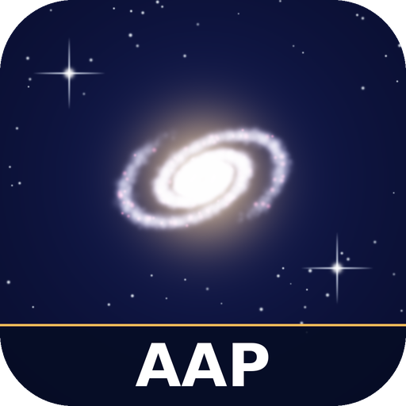

<p align="center"></p>

# AutoAstroPipe

*From raw FITS images to a scientific analysis, in seven guided steps — any telescope, any band* — original Italian name: «AutoAstroPipe (AAP)»

AutoAstroPipe (AAP) takes a folder of FITS files from space or ground telescopes, in any band (UV, visible, infrared, X-rays…), and guides you through seven sections: renaming by filter, noise reduction, background, stretching, alignment and stacking, scientific analyses, and colour finishing. It reads JWST, Hubble, Spitzer, WISE, Pan-STARRS, Herschel, SPHEREx cubes and Roman `.asdf` files, and keeps the WCS so that the results remain scientifically usable. Until version 1.4 it was called [Pipeline FITS](https://github.com/EDOKILLER/pipeline-fits).

## Features

* Seven collapsible sections, choices saved per file (`aap_scelte.csv`), resume an analysis at any time
* Analyses: photometry, sky map of the constellation (IAU-style chart), named objects from SIMBAD/NED and the included OpenNGC catalogue
* Reprojection and stacking with `reproject`, Roman ASDF reader, colour finishing
* Interface in Italian **or English** (2.6), adjustable text size, © signature option
* Full manual in Italian and English (`documentazione/`)

> **Language note.** The interface is in **Italian** (large, adjustable text); plots, PDF/PNG cards and scientific output are in **English**. Code comments are in Italian. The original Italian guide is [`LEGGIMI.txt`](LEGGIMI.txt).

**Version:** 2.6 (2026-11-15). **Status:** 2.5 built and tested on real data (NGC 7635: Pan-STARRS, WISE, Spitzer, SPHEREx, Herschel); 2.6 adds the English interface.

## Quick start

Requirements: Python 3.10+ (tested with Python 3.14 on Ubuntu) with `tkinter` (Ubuntu: `sudo apt install python3-tk`).

```bash
git clone https://github.com/EDOKILLER/autoastropipe.git
cd autoastropipe
python3 -m pip install -r requirements.txt

python3 autoastropipe.py --autotest
python3 autoastropipe.py --diagnostica
python3 autoastropipe.py        # opens the window
```

### Standalone executable

`bash crea_eseguibile_ubuntu.sh` builds a single-file executable with PyInstaller in a temporary virtual environment, runs the self-test, and adds the program with its icon to the application menu and the desktop (first time on GNOME: right-click → *Allow launching*). On Windows 11 install Python from python.org (tick *Add python.exe to PATH*) and double-click `crea_eseguibile_windows.bat`.

The build scripts were written for the author's machine: check the paths at the top before running them.

## Data sources and acknowledgements

Data are downloaded at run time from public services. If you publish results, please follow their acknowledgement policies:

* [Mikulski Archive for Space Telescopes (STScI): Hubble, JWST, Kepler, TESS, GALEX, Pan-STARRS](https://archive.stsci.edu/)
* [NASA/IPAC Infrared Science Archive: 2MASS, WISE, Spitzer, Euclid, Planck](https://irsa.ipac.caltech.edu/)
* [SIMBAD database, CDS, Strasbourg](https://simbad.cds.unistra.fr/)
* [NASA/IPAC Extragalactic Database](https://ned.ipac.caltech.edu/)

The file `openngc_compatto.csv` is a compact copy of [OpenNGC](https://github.com/mattiaverga/OpenNGC) by Mattia Verga, licensed under CC BY-SA 4.0 (see `OpenNGC_licenza_CC-BY-SA-4.0.txt`); it keeps that licence, not the BSD licence of the code.

The star and constellation files in `dati_cielo/` come from [d3-celestial](https://github.com/ofrohn/d3-celestial) by Olaf Frohn (BSD 3-Clause).

This project is independent and not endorsed by any of these institutions.

## License

Code: [BSD 3-Clause](LICENSE) © 2026 Edoardo Battistel. You can use, modify and redistribute it, also commercially, as long as you keep the copyright notice; the author's name may not be used to promote derived works without permission. If you use it in research, see [`CITATION.cff`](CITATION.cff).

---
Part of a series of astronomy programs by Edoardo Battistel — see also [X-rays from Black Holes](https://github.com/EDOKILLER/x-rays-from-black-holes) and the other repositories on [this profile](https://github.com/EDOKILLER?tab=repositories).
